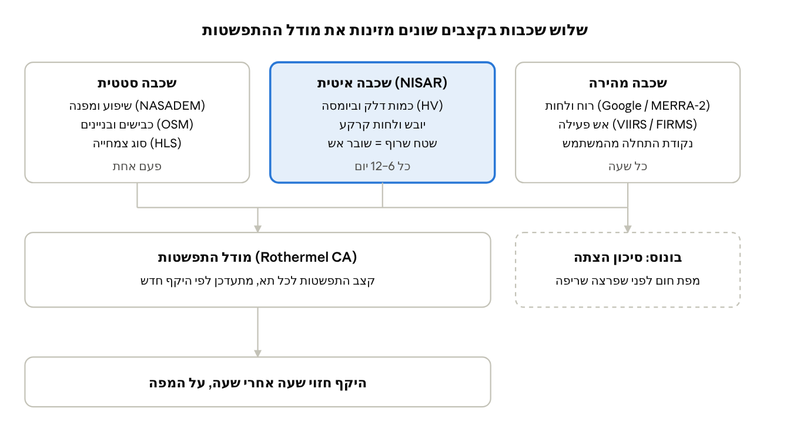

# psagravity: Wildfire Spread Prediction with NISAR

<div dir="rtl">

## בקצרה (קריאה של 3 דקות)

### מה הפרויקט עושה
שריפה כבר בוערת: איפה היא תהיה בעוד כמה שעות? נותנים למערכת את נקודת ההצתה והגודל, והיא חוזה את ההתפשטות.
המודל הוא cellular automaton הסתברותי, שהפרמטרים שלו נלמדים משריפות אמיתיות. השכבות האיטיות (דלק, יובש, אזורים שכבר נשרפו) מגיעות מ-**NISAR** (מכ״ם L-band), והשכבות המהירות מלוויינים שרואים אש כל כמה דקות.

### איזה דאטה ולמה
| מקור | מה נותן | למה |
|---|---|---|
| **NISAR GCOV** (ASF) | backscatter HH/HV, כל 12 יום לכל track | רואה דרך עשן ועננים; דלק, יובש, burn scar |
| **VIIRS** 375 m (FIRMS) | נקודות אש + FRP, ~6 מעברים ביום | מיקום מדויק של האש |
| **GOES-18 FDC** (NOAA) | פיקסלי אש + FRP כל 5 דקות, ~7 קמ״ר לפיקסל | תזמון: מתי האש הגיעה לכל מקום |
| **FEDS** (NASA) | perimeter כל 12 שעות | כיוון וצורת ההתפשטות (השטח הוא חסם תחתון) |
| **NIFC WFIGS** | ה-perimeter הרשמי הסופי, תאריכים | ground truth לשטח הסופי |

**החלטת ground truth:** שטח = WFIGS הסופי; תזמון = VIIRS + GOES; FEDS = כיוון וצורה בלבד.

### מה כבר נעשה
- Pipeline אחד לכל שריפה (`src/firedata/`): הורדה, שיוך detections לשריפה (ומיון שריפות שכנות), טבלאות, גרפים, README לכל שריפה.
- 4 שריפות בארה״ב: Bug (ראשית), Colwash, Biscar, Crosswhite.
- טבלת סיכום עם אחוזי התאמה מול ה-perimeter הרשמי: [`docs/fires_summary.md`](docs/fires_summary.md).
- אתר אחד לכל השריפות עם ציר זמן: [`app/index.html`](app/index.html).
- לא נעשה עדיין: השוואת burn scar של NISAR (issue #7), שריפות באירופה, מודל ההתפשטות.

### המספרים העיקריים
| שריפה | שטח רשמי | FEDS IoU | VIIRS covers | GOES: איחור בזיהוי ראשון | NISAR pairs |
|---|---|---|---|---|---|
| Bug, CA/NV | 93,733 acres | 33% | 39% | 0 דק׳ | 3 |
| Colwash, WA | 39,103 acres | 3% | 6% | 48 דק׳ | 4 |
| Biscar, CA | 69,352 acres | 10% | 26% | 120 דק׳ | 4 |
| Crosswhite, OR | 355,065 acres | בתהליך | בתהליך | בתהליך | בתהליך |

המסקנה: FEDS ו-VIIRS מפספסים חלק גדול מהשטח (בעיקר בריצות מהירות, כמו Colwash, שנשרפה בפחות מיום). GOES רואה כמעט הכל ומהר, אבל בפיקסלים גסים. לכן משלבים: GOES לזמן, VIIRS למיקום, WFIGS לשטח הסופי. ההגדרות המדויקות של כל אחוז: [`docs/fires_summary.md`](docs/fires_summary.md).

### איך מריצים

</div>

```bash
uv venv .venv && uv pip install -r requirements.txt -e .   # or: python -m venv .venv
cp .env.example .env                                        # FIRMS_MAP_KEY (+ Earthdata for NISAR)
.venv/bin/python scripts/build_ground_truth.py colwash      # one fire: data, tables, figures
.venv/bin/python -m firedata.report readme colwash          # fire README
.venv/bin/python -m firedata.report summary bug_fire colwash biscar crosswhite
.venv/bin/python -m firedata.web bug_fire colwash biscar crosswhite --app   # the site in app/
```

<div dir="rtl">

הורדה ראשונה של שריפה לוקחת 5–40 דקות (בעיקר GOES). אחר כך הכל מה-cache ב-`data/fires/<fire>/raw/` (לא נשמר ב-git).

### איפה מה נמצא
| נתיב | מה |
|---|---|
| `src/firedata/` | קוד: `firms`, `goes`, `feds`, `wfigs`, `nisar`, `process`, `metrics`, `report`, `web`, `config` (שריפה חדשה = `FireConfig` חדש) |
| `scripts/build_ground_truth.py` | מריץ את כל ה-pipeline לשריפה אחת |
| `data/fires/<fire>/` | `processed/` (טבלאות), `figures/` (גרפים + דף אינטראקטיבי), `README.md` |
| `docs/fires_summary.md` | טבלת הסיכום + הגדרות המדדים |
| `app/` | האתר |
| `PROGRESS.md` | מצב העבודה הנוכחי |

</div>

---

*Full project description (English) below.*


**When a wildfire is already burning, where will it go next?**

psagravity takes the location and size of a fire that has already been detected, and predicts how it will spread over the next hours. It combines the state of the ground from **NASA-ISRO NISAR** L-band radar (fuel, dryness, burned areas) with active-fire detections, terrain and wind.

Bonus: an **ignition-risk map** that flags dry, fuel-rich areas close to people before a fire starts.

Built for the NASA Space Apps challenge on tracking Earth's surface changes with NISAR.

---

## The problem

Once a fire is detected, incident managers need to know where it will advance: where to send crews, which communities to evacuate first, and where natural firebreaks are. The answer depends on fuel, fuel moisture, terrain and wind, and most of these change across the landscape.

Optical satellites lose the ground under smoke and clouds, exactly when it matters most. Radar does not.

## Why NISAR

| What NISAR gives us | What it does not |
|---|---|
| Sees through smoke and clouds, day and night | Revisits the same place only every 6–12 days |
| L-band (24 cm) is sensitive to vegetation amount and water content | Standard products arrive 36–72 h after acquisition |
| 10–20 m resolution, dual polarization (HH/HV) | |

So NISAR is used for the layers that change **slowly**: fuel structure, dryness and already-burned areas. Everything that changes hour by hour comes from faster sources.

## How it works



| Layer | Updates | Content |
|---|---|---|
| Static | once | Slope and aspect (NASADEM), roads and buildings (OSM), vegetation type (HLS) |
| Slow: NISAR | every 6–12 days | Fuel / biomass (HV), dryness and soil moisture, burned areas as firebreaks |
| Fast | hourly | Wind and humidity (Google Weather / MERRA-2), active fire (VIIRS), user-given ignition point |

### Spread model

A probabilistic cellular automaton on a grid, following Alexandridis et al. (2008). The probability that a burning cell ignites its neighbor is:

$$p_{burn} = p_h\,(1+p_{fuel})\,(1+p_{dry})\;p_{wind}\;p_{slope}$$

- `p_wind = exp(c1·V) · exp(c2·V·(cosθ − 1))`, where θ is the angle between the wind and the spread direction
- `p_slope = exp(a·θ_s)`: fire runs faster uphill
- `p_fuel`, `p_dry` come from the NISAR layers and dead fuel moisture

The parameters (`p_h`, `c1`, `c2`, `a`, …) are **learned from real fires** with a differentiable implementation (as in PyTorchFire), and re-tuned during a fire whenever a new perimeter is observed.

### Validation

Hindcast on real fires observed by NISAR since June 2026: feed the model only what was known at the time, then compare the predicted spread with the observed perimeters (FEDS every 12 h, VIIRS, official perimeters). Metrics: IoU, F1, arrival-time error, **with and without the NISAR layers**.

## Data sources

| Data | Source | Provided by the challenge |
|---|---|---|
| NISAR GCOV (L-band backscatter, HH/HV) | [ASF Vertex](https://search.asf.alaska.edu/) | ✅ |
| NISAR SME2 (soil moisture) | ASF | ✅ |
| VIIRS 375 m active fire (location, FRP) | [Earthdata Search](https://search.earthdata.nasa.gov/) / FIRMS | ✅ |
| FEDS fire perimeters (every 12 h) | [NASA FEDS](https://earth-information-system.github.io/fireatlas/docs/) | ✅ (NASA) |
| NASADEM (30 m) | Earthdata Search | ✅ |
| HLS (Landsat + Sentinel-2) | Earthdata Search | ✅ |
| MERRA-2 (historical weather) | Earthdata Search | ✅ |
| SAOCOM L-band (pre-NISAR fires) | [CONAE](https://catalogos.conae.gov.ar/catalogo/catalogoSatSaocomInfo.html) | ✅ (partner) |
| GOES ABI fire detection (every 5 min) | NOAA | external |
| Live wind and weather | Google Weather API | external |
| Roads and buildings | OpenStreetMap | external |

## Study fires

| Fire | Start | Size | NISAR before / after |
|---|---|---|---|
| **Bug Fire, CA/NV** (primary) | 2026-08-08 | 93,733 acres | 07-23, 07-27 / 08-15, 08-16, 08-20 |
| **Ávila, Spain** (backup) | 2026-07-22 | ~50,000 ha | 07-14, 07-21 / 07-26, 08-19 |
| Le Porge, France | 2026-07-22 | 42,000 ha | 07-14, 07-17 / 07-24, 07-26, 08-10 |
| Rowe Creek / Crosswhite, OR | 2026-07-15 | ~343,000 acres | 07-13, 07-15 / 07-18 → 07-27 |

## Roadmap

- [ ] Select fires and build ground truth (location, intensity, size vs. time)
- [ ] Spread model: spec + input grid
- [ ] Spread model: simulator + learning the parameters
- [ ] Spread model: live update + evaluation
- [ ] Ignition-risk map
- [ ] Web app: terrain layers over time, spread animation, risk map
- [ ] Final report and video

Progress is tracked in the GitHub project **psagravity tasks**.

## Repository structure

```
psagravity/
├── data/fires/<fire>/     # raw / processed data and figures per fire (raw data not committed)
├── docs/                  # design docs, figures
├── src/                   # data loading, NISAR processing, spread model
├── notebooks/             # exploration
└── app/                   # web map
```

## Getting started

```bash
git clone https://github.com/coolpig123/psagravity.git
cd psagravity
python3 -m venv .venv && source .venv/bin/activate
pip install -r requirements.txt
```

Accounts needed: [NASA Earthdata](https://urs.earthdata.nasa.gov/) (free), FIRMS MAP_KEY (free).

## Team

- [name]
- [name]
- [name]

## References

- Rosen et al. NISAR mission. [NISAR Data User Guide (ASF)](https://nisar-docs.asf.alaska.edu/)
- Alexandridis et al. (2008). A cellular automata model for forest fire spread prediction: the case of the wildfire that swept through Spetses Island in 1990. *Applied Mathematics and Computation.*
- Andrews (2018). [The Rothermel surface fire spread model and associated developments](https://research.fs.usda.gov/treesearch/55928). RMRS-GTR-371.
- Xia & Cheng (2025). [PyTorchFire: a GPU-accelerated wildfire simulator with differentiable cellular automata](https://arxiv.org/abs/2502.18738).
- Rochoux et al. (2014, 2015). Towards predictive data-driven simulations of wildfire spread, [Part I](https://nhess.copernicus.org/articles/14/2951/2014/), [Part II](https://nhess.copernicus.org/articles/15/1721/2015/). *NHESS.*
- Rao et al. (2020). [SAR-enhanced mapping of live fuel moisture content](https://doi.org/10.1016/j.rse.2020.111797). *Remote Sensing of Environment.*
- Schroeder et al. (2014). [The New VIIRS 375 m active fire detection data product](https://doi.org/10.1016/j.rse.2013.12.008). *Remote Sensing of Environment.*
- Chen et al. (2022). [California wildfire spread derived using VIIRS satellite observations and an object-based tracking system](https://doi.org/10.1038/s41597-022-01343-0). *Scientific Data.* (FEDS)
- Huot et al. (2022). [Next Day Wildfire Spread](https://arxiv.org/abs/2112.02447). *IEEE TGRS.*
- Gelabert et al. (2025). [Assessing human-caused wildfire ignition likelihood across Europe](https://nhess.copernicus.org/articles/25/4713/2025/). *NHESS.*

## License

[MIT / Apache-2.0: choose one]
