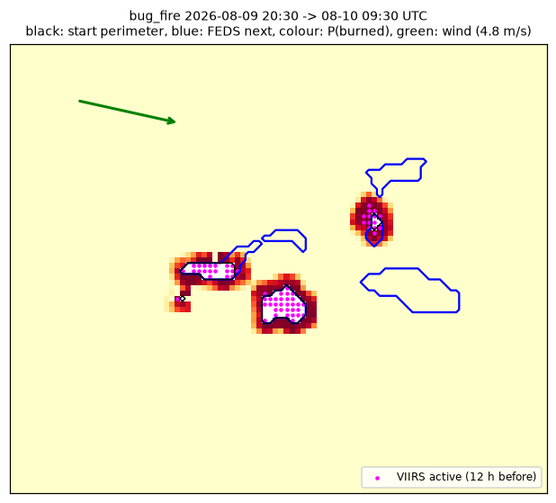

# spread_model: fire-spread probability (Alexandridis CA + fuel moisture)

The `firespread` package computes, for every cell next to the fire, the probability that the fire
spreads into it in the next step. It also reports the most likely spread direction. The model is the
probabilistic cellular automaton of Alexandridis et al. (2008), plus a fuel-moisture term.

Inputs come from two places:
- **Earth Engine** ([`gee_layers`](../gee_layers/README.md)): terrain, vegetation type, land cover, and hourly
  wind, temperature and humidity. They are fetched only around the fire.
- **NISAR** (`real_fires/src/firedata/nisar_provider.py`): vegetation density, soil moisture, vegetation water
  content and burn scars, read from NASA's GCOV and SME2 products over the area around the fire only.

Without NISAR data (no pass, or `nisar` not given), its terms are neutral (factor 1).

## Use it

```python
from firespread import predict, summary

result = predict(polygon=drawn_geojson, start="2026-08-09T21:00Z")  # or point=(lat, lon)
result = predict(polygon=drawn_geojson, start=..., nisar=get_nisar)  # + NISAR: Dataset, NetCDF path or function
print(summary(result))
result["ignition_prob"]     # (y, x): chance each cell catches fire next step  -> map layer for the app
result["p_spread"]          # (direction, y, x): P(burning cell -> neighbour in that direction)
result.attrs["main_direction"], result.attrs["main_direction_deg"], result.attrs["direction_strength"]
```

```bash
cd spread_model
python -m venv .venv && .venv/Scripts/activate
pip install -r requirements.txt -e .       # also installs ../gee_layers (Earth Engine setup: see its README)
pytest
python -m firespread --polygon fire.geojson --start 2026-08-09T21:00Z --out data/spread.nc
python -m firespread --inputs ../gee_layers/data/bug_bundle.nc --nisar nisar.nc   # reuse fetched inputs
```

`predict()` fetches only the Earth Engine layers the model uses (`MODEL_LAYERS`): terrain, landcover,
vegetation_cover and weather (wind, temp_c, rh_pct). It skips Sentinel-2 `vegetation` and gridMET `fuel_dryness`.
It also adds Sentinel-2 burn scars (below); turn them off with `burn_scars=False` / `--no-burn-scars`.

### Several steps: burn probability (Monte Carlo)

`spread_probabilities()` is one CA step: only the cells touching the fire get a probability.
[simulate.py](src/firespread/simulate.py) runs the automaton forward the way Alexandridis does:

- each step, every burning cell tries to ignite each neighbour once, with its `p_spread`;
- then the cell is burned out, and the newly lit cells burn in the next step.

It repeats this in 200 random runs:

```python
from firespread import predict
from firespread.simulate import simulate_spread
sim = simulate_spread(predict(polygon=..., start=...), steps=30)
sim["burn_prob"]      # (y, x): share of runs in which the cell burned within 30 steps
sim["arrival_step"]   # (y, x): mean step at which it caught fire
```

One step moves the fire at most one cell, so 30 steps at 100 m reach at most 3 km. The weather is held at the
start time for all steps, and how many hours a step stands for is not calibrated yet.

### Web app

[web.py](src/firespread/web.py) turns a request from the map UI (`{polygon, start, radius_km, res_m, use_nisar,
burn_scars, steps = 30}`) into a prediction and a JSON answer. The map gets the cells with `burn_prob > 0.01`
(from the simulation above) as GeoJSON squares, plus a summary. [backend/server.py](../backend/server.py) serves it as `POST /api/predict`; how to start the website and
the server is in [frontend/README.md](../frontend/README.md).

### Burn scars from Sentinel-2 (dNBR)

[burn_scars.py](src/firespread/burn_scars.py) marks cells that already burned, so P_mask = 0 there:

```
NBR  = (B8A - B12) / (B8A + B12)                      near-infrared vs shortwave-infrared, 20 m
dNBR = NBR_reference - NBR_current                     burned if dNBR > 0.15
  reference = median of clear pixels, same season a year earlier (t - 365 d ± 30 d)
  current   = newest cloud- and shadow-free pixel in the 30 days before t
```

Using last year's same season keeps the vegetation's seasonal cycle out of the difference. It also means
we don't need to know when a fire happened. The result is `s2_burned` (1 scar, 0 not, -1 no clear pixel)
and `s2_dnbr`, computed at 20 m and averaged to the model cells.

Bug Fire check against the official perimeter (100 m cells):

| As of | Recall | Precision | False alarms outside |
|---|---|---|---|
| 08-16 00Z, before any clear post-fire image (smoke) | 34% | 92% | 1.2% |
| 08-17, first clear image after the fire | 78% | 97% | 1.1% |
| 08-31 | 70% | 96% | 1.1% |
| *NISAR HV change, 08-16 (for comparison)* | *41%* | *90%* | *2.0%* |

Optical can't see through smoke, so while a fire is burning the radar `nisar_burned` (which still applies) is
the only scar source. Recall is measured against the outer perimeter, which also contains unburned islands.
It is called only when `predict()` fetches the inputs, or with `burn_scars=True`.

## The model

For a burning cell *i* and each of its 8 neighbours *j*, at time *t*:

```
P_burn(i -> j, t) = clip( P0 · (1 + P_veg[j]) · (1 + P_den[j]) · P_w(i -> j, t) · P_s(i -> j) · P_m(j, t) · P_mask[j] · D(i -> j), 0, 1 )
```

An unburned cell *j* catches fire in the next step with probability `1 - Π_i (1 - P_burn(i -> j))` over its
burning neighbours, which gives `ignition_prob`.

| Factor | Formula | Values / inputs | Source |
|---|---|---|---|
| **P0** | constant | 0.58: spread on flat ground, no wind, reference fuel | paper |
| **P_veg** | lookup by vegetation type of *j* | forest **+0.4**, shrub **0**, grass / crops **−0.3** | GEE: LANDFIRE `fuel_lifeform` (WorldCover outside the US) |
| **P_den** | lookup by vegetation cover % of *j* | sparse (< 30 %) **−0.4**, normal **0**, dense (≥ 60 %) **+0.3**; no data → **0** | **NISAR only**: `nisar_cover_pct` |
| **P_w** | `exp(c1·V) · exp(c2·V·(cos θ − 1))` | V = wind speed (m/s) at *i*; θ = angle between the direction the wind blows **toward** and *i → j*; c1 = 0.045, c2 = 0.131 s/m | GEE: hourly wind |
| **P_s** | `exp(a·θs)`, `θs = atan((E_j − E_i) / l)` | E = elevation (m); l = cell size, × √2 for diagonals; θs in degrees (> 0 uphill); a = 0.078 /deg | GEE: NASADEM |
| **P_m** | `P_emc · (1 + P_dry) · (1 + P_vwc)` | fuel moisture, see below | GEE hourly + NISAR |
| **P_mask** | 1 or 0 | 0 if *j* cannot burn: burning now, no fuel, WorldCover built-up / bare / snow / water, NISAR or Sentinel-2 burn scar, or outside the grid | GEE + NISAR `nisar_burned` + Sentinel-2 `s2_burned` |
| **D** | 1 or 1/√2 | 1 for N/E/S/W, **1/√2 for diagonals** (they are √2 cells away; equal expected advance per step) | ours |

### P_m: fuel moisture (fast air moisture × slow ground and vegetation moisture)

```
P_m(j, t) = P_emc(j, t) · (1 + P_dry[j]) · (1 + P_vwc[j])
```

**P_emc** is how dry the fine dead fuel is right now. It comes from the hourly air temperature and humidity
at *j* (`temp_c`, `rh_pct`, from Earth Engine) through the Simard (1968) equilibrium moisture content, as used in
the US National Fire Danger Rating System. With `T_f = temp_c · 1.8 + 32` and `H = clip(rh_pct, 0, 100)`:

| Humidity | EMC (%) |
|---|---|
| H < 10 | `0.03229 + 0.281073·H − 0.000578·H·T_f` |
| 10 ≤ H < 50 | `2.22749 + 0.160107·H − 0.014784·T_f` |
| H ≥ 50 | `21.0606 + 0.005565·H² − 0.00035·H·T_f − 0.483199·H` |

```
P_emc = exp( −b_emc · (EMC − emc_ref) )        b_emc = 0.05 per %, emc_ref = 8 %
```

Hot, dry air (EMC < 8 %) gives P_emc > 1, so the fire spreads faster. Cool, humid air (EMC > 8 %) gives
P_emc < 1. Missing weather, or a cell with no weather, gives 1.

**P_dry** is how dry the ground is. It comes from NISAR soil moisture (`nisar_soil_moisture`, SME2): dry
(< 0.10 m³/m³) gives **+0.3**, normal **0**, wet (≥ 0.25) **−0.3**. Without NISAR it is **0**.

**P_vwc** is how much water the live vegetation holds. It comes from NISAR vegetation water content
(`nisar_vwc_kg_m2`, SME2): low (< 0.5 kg/m², e.g. cured grass or dry shrub) gives **+0.2**, normal **0**, high
(≥ 4 kg/m², well-watered live canopy) **−0.2**. Without NISAR it is **0**. VWC also grows with the amount of
vegetation, so it partly overlaps P_veg and P_den. That's why its effect is kept small until it is calibrated.

The output keeps every part: `emc_pct`, `p_emc`, `p_dry`, `p_vwc` and `p_m`. `attrs["source_p_m"]` and the
summary say which sources were used.

### Parameters

- **From the paper** (fitted on a 1990 fire in Greece): P0, c1, c2, a, P_veg and P_den.
- **Our additions, placeholders to fit later:** P_m (`b_emc`, `emc_ref_pct`, the P_dry and P_vwc thresholds and
  values) and D.

All of them are in `AlexandridisParams`, so they can be learned from our fires. `diagonal_factor=1.0` gives back
the paper's original model.

**Most likely direction:** for each of the 8 directions, the expected number of ignitions is summed over the
whole fire front (`expected_N`, ..., `expected_NW`). The resultant of those 8 vectors gives `main_direction_deg`.
`direction_strength` is 0 when the fire spreads evenly all round and 1 when everything goes one way. It uses the
clipped probabilities, because a cell can only catch fire once. The summary reports how many spreads were clipped.

**Weather time:** the model uses the last weather step at or before the requested time. If there is none, it uses
the first step. If the weather is more than 2 h older than the requested time, it still runs, but `weather_note`
and the summary warn about it.

## NISAR interface (for the NISAR module)

Everything the two modules share is in [src/firespread/nisar.py](src/firespread/nisar.py). The NISAR module can
plug in either way:

1. **A Dataset or NetCDF file:** `predict(..., nisar=ds)` or `--nisar file.nc`.
2. **A function** (recommended): `predict(..., nisar=get_nisar)`. It is called with a `NisarRequest` that holds
   exactly what to deliver:
   - `crs`, and `x`, `y`: the model grid (cell centres, metres);
   - `res_m`: the cell size;
   - `bbox_lonlat`: the area to search ASF for (only around the fire);
   - `time_utc`: the prediction start, so the NISAR module can pick the latest pass before it.

   The function returns a Dataset, or `None` when it has no data for that place or time.

```python
from firespread import NisarRequest, nisar_template

def get_nisar(request: NisarRequest):
    ds = nisar_template(request)                 # empty Dataset on the right grid, crs set
    ds["nisar_soil_moisture"] = (("y", "x"), soil_moisture_on_grid)   # shape (len(request.y), len(request.x))
    ds["nisar_cover_pct"] = (("y", "x"), cover_on_grid)
    ds["nisar_burned"] = (("y", "x"), burned_on_grid.astype("int16"))
    return ds
```

| Variable | Units | Meaning | Used in |
|---|---|---|---|
| `nisar_cover_pct` | % | vegetation / canopy cover from HV backscatter or biomass | P_den |
| `nisar_soil_moisture` | m³/m³ | surface soil moisture (SME2) | P_dry, inside P_m |
| `nisar_vwc_kg_m2` | kg/m² | vegetation water content (SME2, PMI retrieval) | P_vwc, inside P_m |
| `nisar_burned` | 0/1 (integer) | already burned, from L-band change detection | P_mask = 0 |

**The provider that exists today** is `firedata.nisar_provider.nisar_provider()` (in `real_fires/`):

```python
from firedata.nisar_provider import nisar_provider
result = predict(polygon=drawn_geojson, start="2026-08-09T21:00Z", nisar=nisar_provider())
```

It needs Earthdata credentials in `real_fires/.env`. What it does is described at the top of
[nisar_provider.py](../real_fires/src/firedata/nisar_provider.py).

Every variable is optional. Use NaN (float) or −1 (integer) for no data.

The data is aligned by `align_nisar` **by coordinates, never by array position**:
- On the request grid, values are used as they are.
- Same CRS but another resolution, extent or axis order gets regridded: continuous variables bilinearly, integer
  variables by nearest cell.
- A different or missing CRS, or an unknown variable name, raises an error.

For NISAR data much finer than the model grid (10-30 m vs 100 m), average it to about the model resolution first.

**Changing the NISAR contract** (adding a variable, say) means editing `NISAR_VARIABLES` in `nisar.py`, plus one
factor function in [alexandridis.py](src/firespread/alexandridis.py) and its test.

## Live check (Bug Fire, 2026-11-14)

This uses the published parameters, the diagonal correction, one CA step, 100 m cells and no NISAR yet. The
predicted direction is compared with where the next FEDS perimeter actually grew:

| Start (perimeter) | Predicted direction | Strength | Actual growth toward |
|---|---|---|---|
| ignition point, 08-08 22:30 | E (99°) | 0.57 | (no next perimeter yet) |
| 08-09 20:30 perimeter | SE (139°) | 0.27 | 74° (ENE) |
| 08-10 20:30 perimeter | NE (30°) | 0.22 | 354° (N) |
| 08-11 09:30 perimeter | SW (230°) | 0.05 (no clear direction) | 18° (NNE) |

The moisture term behaves as expected on the same fire. On 08-09 at 21:00 UTC (afternoon) EMC was 2.4-3.5 % and
P_m 1.25-1.32. Before dawn on 08-10 (09:00 UTC) EMC was 4.2-7.7 % and P_m 1.02-1.21. That is the daily cycle that
makes afternoons the main burning period.

The direction is 36-65° off, in roughly the right half-plane on 2 of 3 perimeters. That is expected before
calibration:
- The parameters come from Greece.
- One step covers 100 m, while the perimeters are 12 h apart.
- There is no NISAR density or soil moisture yet.

Next steps:
- learn the parameters from the four real fires;
- run many CA steps with hourly weather and compare whole perimeters;
- connect the NISAR provider.

## First calibration on real fires (2026-11-14)

Code: [calibrate.py](src/firespread/calibrate.py).

```
python -m firespread.calibrate fetch bug_fire colwash biscar
python -m firespread.calibrate fit --train bug_fire --test colwash biscar crosswhite
```

The fetch caches the inputs in `data/calibration/`, which is not committed.

**Setup:**
- **Examples:** each one is a 12 h (or 24 h) FEDS segment. The model starts from the perimeter at t0 and predicts
  the perimeter at t1. Segments where the fire grew less than 0.5 km² are skipped.
- **Data:**
  - 7 Bug Fire segments to train on.
  - 7 segments on 3 other fires to test on: Colwash (1), Biscar (2) and the first 4 of Crosswhite.
- **Inputs:**
  - Earth Engine only, at 400 m;
  - weather at 21 UTC (14:00 local, the afternoon peak) inside each segment;
  - no NISAR and no Sentinel-2.
- **Fire front:** spread starts only from cells where VIIRS saw fire in the 12 h before t0. The rest of the
  perimeter counts as burned out.
- **Fitted by grid search:** `p0`, a wind multiplier on `c1` and `c2`, and the number of CA steps per 12 h (the
  first measured time unit). Slope and moisture keep the paper values.
- **Score:** soft IoU on the **new burned area only**: P(burned) outside the start perimeter compared with the
  growth seen by FEDS. A "no growth" forecast scores 0 on it.

**Result:** mean growth IoU per segment.

| | Train (Bug Fire, 7) | Test (3 other fires, 7) |
|---|---|---|
| No growth | 0.000 | 0.000 |
| Paper `p0` and wind (steps per 12 h fitted: 2) | 0.060 | 0.101 |
| **Fitted:** `p0` 0.8, wind ×0.5, 2 steps per 12 h | **0.066** | **0.112** |

**What we learned:**
1. **Time unit:** at 400 m, the best fit is **2 CA steps per 12 h** (one step ≈ 6 h, at most 0.4 km per step).
   More steps spread the fire around the whole front and add false alarms faster than they add hits.
2. **Spreading from the VIIRS-active cells, not the whole perimeter, helps:** test growth IoU rose from 0.095 to
   0.107 with the same weather. Most of a big fire's edge is not burning.
3. **The skill is still low (about 11% of the new area), and the figure shows why.** The Bug Fire's big run on
   08-09/10 grew by **spotting**: the new areas (blue) lie 1–3 km downwind (east) and are not connected to the
   start perimeter (black). A neighbour-to-neighbour automaton cannot jump. The fitted wind multiplier (×0.5) is a
   symptom: stronger wind pushes P(burned) further along the edge it touches, but the real growth appears
   elsewhere.

   
4. **Some parameters lie at the edge of the grid** (`p0` = 0.8, the highest value tried), so the search should
   be widened before these values are trusted.

### Joint search with spotting (2026-11-15)

Code: [calibrate_search.py](src/firespread/calibrate_search.py).

```
python -m firespread.calibrate fetch crosswhite
python -m firespread.calibrate_search --minutes 40
```

**What changed from the first calibration:**
- **Data:** 57 segments on all 4 fires: Bug 7, Colwash 1, Biscar 2, Crosswhite 47.
- **Spotting:** Gemini's ember jumps, with the same formula, are now part of the calibration simulation. The
  embers can be lofted by the gust speed (RTMA `gust_ms`, about twice the mean wind) instead of the mean wind.
- **Search:** 608 random and refined sets of 11 parameters in 40 minutes. The parameters are `p0`, the wind,
  slope and moisture strengths, CA steps per 12 h, and 6 spotting parameters.
- **Score:** the share of the new burned area found (growth IoU), averaged with equal weight per fire.

| Growth IoU | Biscar | Bug | Colwash | Crosswhite | Mean |
|---|---|---|---|---|---|
| Paper values | 0.044 | 0.060 | 0.028 | 0.160 | 0.073 |
| Gemini's spotting defaults | 0.043 | 0.060 | 0.027 | 0.160 | 0.073 |
| Best set, fitted on all 4 fires | 0.085 | 0.064 | 0.033 | 0.161 | **0.086** |
| **Leave one fire out** (fitted on 3, scored on the 4th) | 0.027 | 0.044 | 0.033 | 0.118 | **0.055** |

The best set:
- `p0` 0.75, wind ×0.29, slope ×0.63, `b_emc` 0.066, 1 step per 12 h;
- spotting: chance 0.42, triggered by **gusts** above 4.6 m/s, jumps of at least 835 m plus 229 m per m/s, in a
  ±12° cone.

**What we learned:**
1. **The fit doesn't carry over to new fires.** Fitted on all 4 fires the score rises 18% (0.073 → 0.086). But
   when each fire is held out, the chosen set scores *lower* than the paper's values on 3 of the 4 fires (mean
   0.055 vs 0.073).
   - With 11 parameters and 4 fires, the search learns the quirks of individual fires. Most of the gain comes from
     Biscar's 2 segments.
   - **So the app keeps the paper's values.**
2. **Spotting adds almost nothing yet.** The best set with spotting switched off scores 0.085 against 0.086.
   - Gusts and long jumps are what the search prefers, which is consistent with the Bug Fire picture.
   - But one random ember per burning cell per step rarely lands where FEDS saw the new area.
3. **Fewer steps keep winning (1 per 12 h).** Every extra step spreads the fire all round the active front. So
   the model's main error is *where* the fire goes, not how fast.

**To make training work:**
- Fit fewer parameters at a time: `p0`, the wind strength and steps per 12 h, then spotting separately.
- Weight each fire by its number of segments, or add more fires. Colwash has only 1 segment.
- Use more Monte Carlo runs, to cut the noise.
- Fix the structural gaps first:
  - weather that changes hour by hour inside the 12 h;
  - wind direction at the scale of the fire (RTMA is smoothed at 2.5 km);
  - a fuel model;
  - a step duration from the rate of spread (Rothermel).

**Next:**
- Add **spotting**: a random jump of 0.5–3 km downwind, more likely in strong wind and dry air.
- Give each step a duration from the rate of spread (Rothermel), with hourly weather.
- Fit on all 4 fires: train on 3, test on the 4th, rotating.
- Score arrival times against GOES and VIIRS.
- Compare with and without NISAR.
